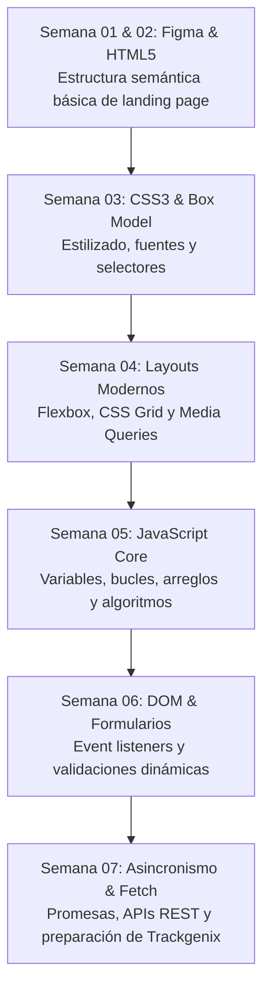

# 🚀 BaSP 2022 - Etapa 1: Fundamentos de Desarrollo Web (Radium Rocket)

[](https://developer.mozilla.org/es/docs/Web/HTML)
[](https://developer.mozilla.org/es/docs/Web/CSS)
[](https://developer.mozilla.org/es/docs/Web/JavaScript)
[]()
[]()

Repositorio de trabajo, prácticas semanales y entregas progresivas de la **Etapa 1** del bootcamp formativo **"Become a Software Professional" (BaSP 2022)** de **Radium Rocket**.

Esta etapa sentó las bases de ingeniería frontend, maquetación semántica y desarrollo interactivo con JavaScript que culminaron en la construcción de la plataforma de gestión de horas y recursos humanos **Trackgenix**.

---

## 📅 Hoja de Ruta Formativa (Semanas 01 a 07)



### Detalle de Módulos:
* **Semana 01 / 02:** Análisis de especificaciones de diseño en Figma y traducción a etiquetas semánticas de HTML5 (`<header>`, `<nav>`, `<main>`, `<section>`, `<article>`, `<footer>`).
* **Semana 03:** Integración de hojas de estilo (`styles.css`), aplicación de `resets` normalizados, cascada y especificidad.
* **Semana 04:** Maquetación responsiva (*mobile-first*), alineaciones con Flexbox y cuadrículas con CSS Grid.
* **Semana 05:** Fundamentos de programación en JavaScript: tipos de datos primitivos, condicionales, funciones puras y manipulación de listas.
* **Semana 06:** Interacción viva con el navegador mediante la API del DOM (`document.querySelector`), captura de eventos de teclado y ratón, y validación exhaustiva de inputs de formulario en tiempo real con mensajes de error visuales.
* **Semana 07:** Introducción al asincronismo en JavaScript: manejo de `Promise`, `async/await`, peticiones HTTP con `fetch()` y estructuración de la futura aplicación completa de Trackgenix.

---

## 📁 Estructura del Repositorio

```
BaSP-M2022-Etapa-1/
├── resets/          # Hojas de estilo de normalización y reseteo CSS
├── semana-02/       # Estructura inicial y maquetado de landing page
├── semana-03/       # Aplicación de reglas de estilo CSS3
├── semana-04/       # Adaptabilidad responsiva con Flexbox y Grid
├── semana-05/       # Ejercicios algorítmicos y funciones JavaScript
├── semana-06/       # Control del DOM y validación de formularios interactivos
├── semana-07/       # Consumo asíncrono y preparación de Trackgenix
└── README.md        # Bitácora formativa del bootcamp
```

---

## 👤 Autor

**Gabriel Vázquez**  
*Docente de Informática & Full Stack Developer*  
* [GitHub Profile](https://github.com/gavafue)  
* [LinkedIn](https://www.linkedin.com/in/gavafue/)
